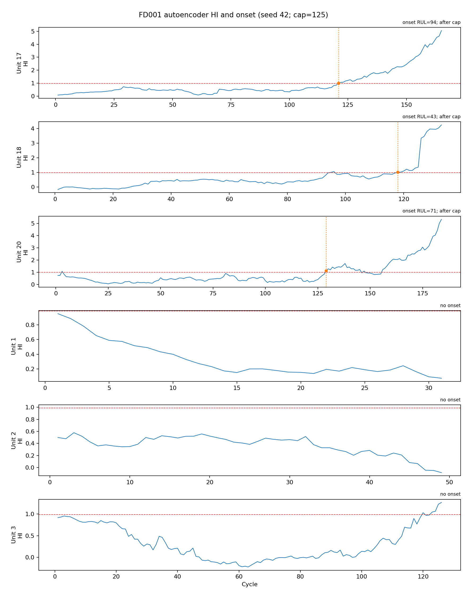
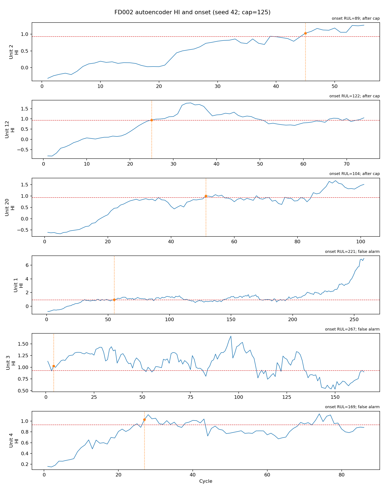
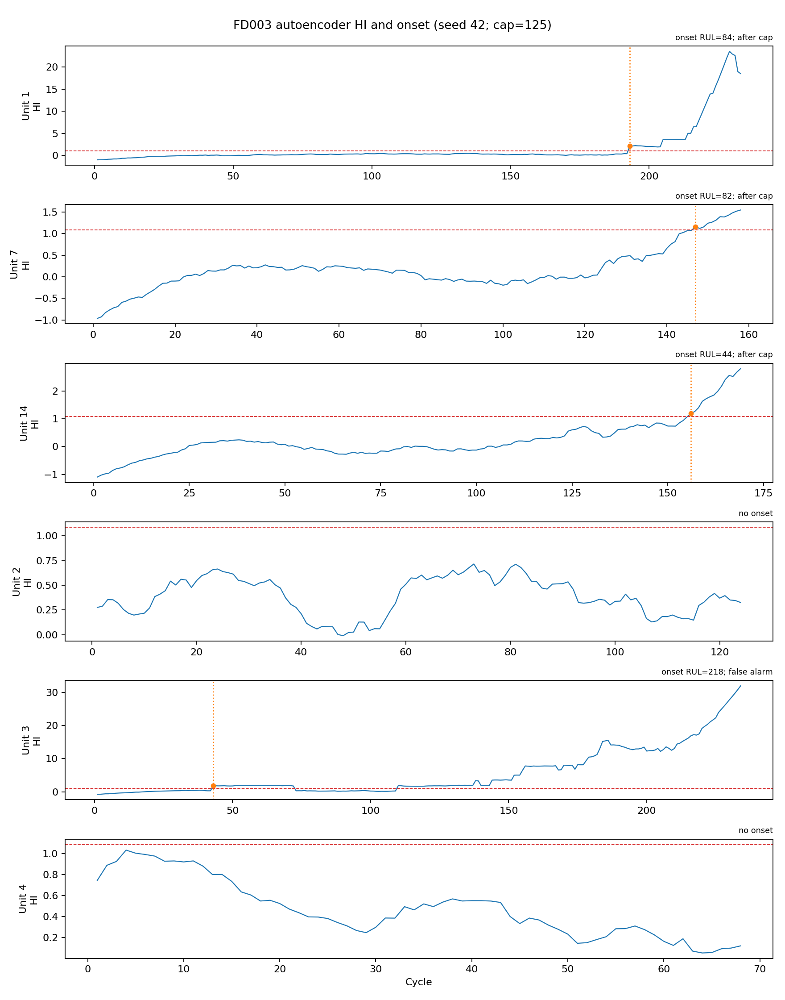
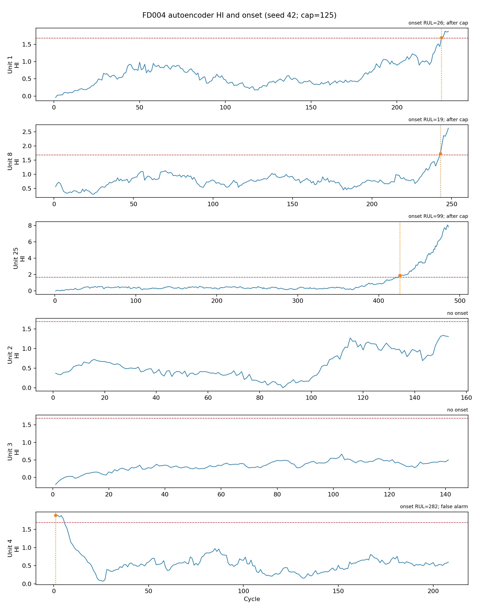

# CMAPSS final results (seeds 42, 43, 44)

For the complete per-model breakdown, see [`MODEL_RESULTS.md`](MODEL_RESULTS.md).

Every mean is over the three listed seeds; ± is sample standard deviation (ddof=1).
`val_last` uses the last validation endpoint and five fixed-seed random truncation endpoints per validation engine (sampling seed 42). It is the selection metric; official test metrics are descriptive only.
A test RMSE gap is called better/worse than baseline only when the mean paired LightGBM-minus-model gap exceeds the sample standard deviation of those three paired gaps; all smaller gaps are within noise.

## FD001

### Validation ranking (val_last clipped RUL)

| Rank | Model | RMSE | MAE | MSE | NASA score | R² |
|---:|---|---:|---:|---:|---:|---:|
| 1 | 08_ensemble | 10.3571 ± 0.3784 | 6.7763 ± 0.2185 | 107.3660 ± 7.7936 | 214.5169 ± 24.5551 | 0.9512 ± 0.0035 |
| 2 | 05_transformer | 11.0794 ± 0.4533 | 7.5024 ± 0.1854 | 122.8897 ± 10.0238 | 270.4995 ± 37.9531 | 0.9441 ± 0.0046 |
| 3 | 02_lstm | 11.1007 ± 0.7824 | 7.3717 ± 0.6080 | 123.6341 ± 17.3325 | 242.9593 ± 45.1146 | 0.9438 ± 0.0079 |
| 4 | 03_bilstm_attention | 11.7958 ± 0.5602 | 8.1383 ± 0.3484 | 139.3503 ± 13.0861 | 327.2976 ± 21.8198 | 0.9367 ± 0.0059 |
| 5 | 01_lightgbm | 12.6444 ± 0.0883 | 8.6908 ± 0.1499 | 159.8859 ± 2.2374 | 519.1923 ± 35.3174 | 0.9273 ± 0.0010 |
| 6 | 07_cnn_transformer | 13.4836 ± 0.6924 | 9.8007 ± 0.4579 | 182.1266 ± 18.9301 | 451.7469 ± 114.6856 | 0.9172 ± 0.0086 |
| 7 | 04_cnn1d | 15.5295 ± 0.5082 | 11.1063 ± 0.3883 | 241.3374 ± 15.6360 | 974.4356 ± 552.4057 | 0.8903 ± 0.0071 |
| 8 | 06_autoencoder | 16.2273 ± 0.3757 | 12.1259 ± 0.3323 | 263.4210 ± 12.1236 | 821.8530 ± 151.0845 | 0.8803 ± 0.0055 |

### Raw official test RUL

| Model | RMSE | MAE | MSE | NASA score | R² | RMSE vs baseline |
|---|---:|---:|---:|---:|---:|---|
| 01_lightgbm | 14.5843 ± 0.2403 | 11.2797 ± 0.1240 | 212.7408 ± 7.0029 | 334.7998 ± 14.0341 | 0.8768 ± 0.0041 | baseline |
| 02_lstm | 15.9362 ± 0.5058 | 11.7141 ± 0.7232 | 254.1340 ± 16.2359 | 370.8078 ± 49.6685 | 0.8528 ± 0.0094 | worse than baseline (gap -1.3519, paired SD 0.3814) |
| 03_bilstm_attention | 14.9103 ± 0.1411 | 11.1026 ± 0.2557 | 222.3318 ± 4.2044 | 417.3441 ± 55.1334 | 0.8713 ± 0.0024 | worse than baseline (gap -0.3260, paired SD 0.1830) |
| 04_cnn1d | 18.7104 ± 0.0649 | 13.9675 ± 0.4140 | 350.0801 ± 2.4312 | 750.7395 ± 74.5580 | 0.7973 ± 0.0014 | worse than baseline (gap -4.1260, paired SD 0.1801) |
| 05_transformer | 15.0099 ± 0.1772 | 11.1699 ± 0.3930 | 225.3177 ± 5.3020 | 342.5312 ± 25.1384 | 0.8695 ± 0.0031 | worse than baseline (gap -0.4256, paired SD 0.3906) |
| 06_autoencoder | 17.6102 ± 0.5668 | 13.7913 ± 0.6228 | 310.3320 ± 20.0004 | 717.8893 ± 92.9151 | 0.8203 ± 0.0116 | worse than baseline (gap -3.0258, paired SD 0.3298) |
| 07_cnn_transformer | 16.9290 ± 0.2360 | 12.8472 ± 0.0914 | 286.6297 ± 7.9918 | 462.8304 ± 20.0599 | 0.8340 ± 0.0046 | worse than baseline (gap -2.3447, paired SD 0.2297) |
| 08_ensemble | 14.0373 ± 0.1864 | 10.4089 ± 0.4138 | 197.0685 ± 5.2150 | 277.2331 ± 1.6501 | 0.8859 ± 0.0030 | better than baseline (gap +0.5470, paired SD 0.1302) |

### Clipped test RUL

| Model | RMSE | MAE | MSE | NASA score | R² | RMSE vs baseline |
|---|---:|---:|---:|---:|---:|---|
| 01_lightgbm | 13.4825 ± 0.2395 | 10.2097 ± 0.1240 | 181.8149 ± 6.4625 | 306.3101 ± 13.5651 | 0.8868 ± 0.0040 | baseline |
| 02_lstm | 14.8047 ± 0.7288 | 10.6479 ± 0.7296 | 219.5330 ± 21.7202 | 336.7682 ± 57.0289 | 0.8633 ± 0.0135 | worse than baseline (gap -1.3222, paired SD 0.5957) |
| 03_bilstm_attention | 13.7060 ± 0.2717 | 10.0329 ± 0.2560 | 187.9044 ± 7.4500 | 384.9210 ± 59.6138 | 0.8830 ± 0.0046 | within noise (gap -0.2236, paired SD 0.2702) |
| 04_cnn1d | 17.2789 ± 0.0336 | 12.8975 ± 0.4140 | 298.5599 ± 1.1629 | 688.5131 ± 75.5709 | 0.8141 ± 0.0007 | worse than baseline (gap -3.7964, paired SD 0.2207) |
| 05_transformer | 13.7445 ± 0.1985 | 10.1104 ± 0.4110 | 188.9366 ± 5.4769 | 306.4168 ± 29.9403 | 0.8823 ± 0.0034 | within noise (gap -0.2620, paired SD 0.3455) |
| 06_autoencoder | 16.4707 ± 0.5150 | 12.7248 ± 0.6169 | 271.4621 ± 16.9725 | 676.2996 ± 89.9374 | 0.8310 ± 0.0106 | worse than baseline (gap -2.9883, paired SD 0.2758) |
| 07_cnn_transformer | 15.4792 ± 0.1765 | 11.7813 ± 0.0950 | 239.6275 ± 5.4702 | 403.3188 ± 46.4582 | 0.8508 ± 0.0034 | worse than baseline (gap -1.9968, paired SD 0.3669) |
| 08_ensemble | 12.7542 ± 0.1932 | 9.3389 ± 0.4138 | 162.6938 ± 4.9195 | 245.7613 ± 4.8366 | 0.8987 ± 0.0031 | better than baseline (gap +0.7283, paired SD 0.0604) |

### Validation metrics (raw and clipped)

| Model | Target | RMSE | MAE | MSE | NASA score | R² |
|---|---|---:|---:|---:|---:|---:|
| 01_lightgbm | raw | 26.0913 ± 0.0788 | 16.5788 ± 0.1585 | 680.7599 ± 4.1137 | 5022.4934 ± 176.2933 | 0.8094 ± 0.0012 |
| 01_lightgbm | clipped | 12.6444 ± 0.0883 | 8.6908 ± 0.1499 | 159.8859 ± 2.2374 | 519.1923 ± 35.3174 | 0.9273 ± 0.0010 |
| 02_lstm | raw | 25.6483 ± 0.1424 | 15.2703 ± 0.6262 | 657.8468 ± 7.3004 | 5025.5057 ± 465.0761 | 0.8158 ± 0.0020 |
| 02_lstm | clipped | 11.1007 ± 0.7824 | 7.3717 ± 0.6080 | 123.6341 ± 17.3325 | 242.9593 ± 45.1146 | 0.9438 ± 0.0079 |
| 03_bilstm_attention | raw | 25.6206 ± 0.5108 | 15.9248 ± 0.3791 | 656.5904 ± 26.3183 | 4820.0706 ± 518.7247 | 0.8162 ± 0.0074 |
| 03_bilstm_attention | clipped | 11.7958 ± 0.5602 | 8.1383 ± 0.3484 | 139.3503 ± 13.0861 | 327.2976 ± 21.8198 | 0.9367 ± 0.0059 |
| 04_cnn1d | raw | 29.4569 ± 0.2580 | 18.9544 ± 0.3147 | 867.7521 ± 15.2371 | 10182.1588 ± 2882.8066 | 0.7571 ± 0.0043 |
| 04_cnn1d | clipped | 15.5295 ± 0.5082 | 11.1063 ± 0.3883 | 241.3374 ± 15.6360 | 974.4356 ± 552.4057 | 0.8903 ± 0.0071 |
| 05_transformer | raw | 24.9796 ± 0.3515 | 15.1153 ± 0.1330 | 624.0646 ± 17.5993 | 4811.1691 ± 427.8812 | 0.8253 ± 0.0049 |
| 05_transformer | clipped | 11.0794 ± 0.4533 | 7.5024 ± 0.1854 | 122.8897 ± 10.0238 | 270.4995 ± 37.9531 | 0.9441 ± 0.0046 |
| 06_autoencoder | raw | 29.4546 ± 0.4602 | 19.8181 ± 0.1709 | 867.7129 ± 27.0374 | 8374.5019 ± 844.8525 | 0.7571 ± 0.0076 |
| 06_autoencoder | clipped | 16.2273 ± 0.3757 | 12.1259 ± 0.3323 | 263.4210 ± 12.1236 | 821.8530 ± 151.0845 | 0.8803 ± 0.0055 |
| 07_cnn_transformer | raw | 26.6067 ± 0.8929 | 16.9939 ± 0.4311 | 708.4490 ± 47.2463 | 6852.9311 ± 2455.3975 | 0.8017 ± 0.0132 |
| 07_cnn_transformer | clipped | 13.4836 ± 0.6924 | 9.8007 ± 0.4579 | 182.1266 ± 18.9301 | 451.7469 ± 114.6856 | 0.9172 ± 0.0086 |
| 08_ensemble | raw | 25.0553 ± 0.2584 | 14.6200 ± 0.2326 | 627.8110 ± 12.9712 | 4584.1558 ± 282.6855 | 0.8243 ± 0.0036 |
| 08_ensemble | clipped | 10.3571 ± 0.3784 | 6.7763 ± 0.2185 | 107.3660 ± 7.7936 | 214.5169 ± 24.5551 | 0.9512 ± 0.0035 |

Best by val_last RMSE: **08_ensemble**. Best by val_last NASA score: **08_ensemble**.

## FD002

### Validation ranking (val_last clipped RUL)

| Rank | Model | RMSE | MAE | MSE | NASA score | R² |
|---:|---|---:|---:|---:|---:|---:|
| 1 | 08_ensemble | 11.5296 ± 0.2788 | 7.6762 ± 0.1821 | 132.9839 ± 6.4014 | 801.8596 ± 23.0774 | 0.9455 ± 0.0026 |
| 2 | 02_lstm | 11.7405 ± 0.5050 | 8.3347 ± 0.6242 | 138.0098 ± 11.7286 | 817.8478 ± 45.1734 | 0.9434 ± 0.0048 |
| 3 | 05_transformer | 12.9446 ± 0.1844 | 8.8774 ± 0.1331 | 167.5842 ± 4.7842 | 1269.9788 ± 231.6145 | 0.9313 ± 0.0020 |
| 4 | 03_bilstm_attention | 13.4048 ± 0.1350 | 9.3304 ± 0.4364 | 179.7019 ± 3.6286 | 1350.4749 ± 124.2745 | 0.9263 ± 0.0015 |
| 5 | 06_autoencoder | 14.1456 ± 0.4672 | 9.8096 ± 0.4887 | 200.2439 ± 13.2269 | 1423.6522 ± 205.4345 | 0.9179 ± 0.0054 |
| 6 | 01_lightgbm | 14.2564 ± 0.0363 | 10.0271 ± 0.1190 | 203.2449 ± 1.0354 | 1691.6507 ± 60.4722 | 0.9167 ± 0.0004 |
| 7 | 07_cnn_transformer | 15.7734 ± 0.4437 | 11.6435 ± 0.3509 | 248.9298 ± 13.9505 | 1759.9538 ± 323.0971 | 0.8980 ± 0.0057 |
| 8 | 04_cnn1d | 17.7367 ± 0.7065 | 13.3234 ± 0.6842 | 314.9222 ± 25.2100 | 2662.5372 ± 689.2494 | 0.8709 ± 0.0103 |

### Raw official test RUL

| Model | RMSE | MAE | MSE | NASA score | R² | RMSE vs baseline |
|---|---:|---:|---:|---:|---:|---|
| 01_lightgbm | 26.3575 ± 0.1133 | 17.2696 ± 0.0443 | 694.7283 ± 5.9765 | 7788.8212 ± 165.3222 | 0.7598 ± 0.0021 | baseline |
| 02_lstm | 26.4910 ± 1.0875 | 17.5149 ± 0.8760 | 702.5620 ± 57.5401 | 9934.6960 ± 4114.8365 | 0.7571 ± 0.0199 | within noise (gap -0.1335, paired SD 0.9795) |
| 03_bilstm_attention | 26.6599 ± 0.5666 | 17.9717 ± 0.4578 | 710.9659 ± 30.1075 | 7813.1107 ± 621.9931 | 0.7542 ± 0.0104 | within noise (gap -0.3024, paired SD 0.4674) |
| 04_cnn1d | 30.7891 ± 0.0860 | 21.8030 ± 0.3949 | 947.9759 ± 5.3003 | 16570.7832 ± 1522.9518 | 0.6722 ± 0.0018 | worse than baseline (gap -4.4316, paired SD 0.1765) |
| 05_transformer | 26.4374 ± 0.7085 | 17.5007 ± 0.4499 | 699.2703 ± 37.2604 | 7079.7984 ± 783.5199 | 0.7582 ± 0.0129 | within noise (gap -0.0799, paired SD 0.8078) |
| 06_autoencoder | 26.4433 ± 0.2840 | 17.7797 ± 0.4579 | 699.3018 ± 14.9858 | 7851.6018 ± 851.2022 | 0.7582 ± 0.0052 | within noise (gap -0.0858, paired SD 0.3040) |
| 07_cnn_transformer | 27.6964 ± 0.4959 | 18.5852 ± 0.8025 | 767.2572 ± 27.5745 | 10073.7300 ± 915.9288 | 0.7347 ± 0.0095 | worse than baseline (gap -1.3389, paired SD 0.4015) |
| 08_ensemble | 25.5966 ± 0.4650 | 16.8046 ± 0.4451 | 655.3318 ± 23.7746 | 6983.0027 ± 671.6264 | 0.7734 ± 0.0082 | better than baseline (gap +0.7609, paired SD 0.3594) |

### Clipped test RUL

| Model | RMSE | MAE | MSE | NASA score | R² | RMSE vs baseline |
|---|---:|---:|---:|---:|---:|---|
| 01_lightgbm | 13.5258 ± 0.1374 | 9.7903 ± 0.0349 | 182.9604 ± 3.7238 | 782.9750 ± 34.7216 | 0.9008 ± 0.0020 | baseline |
| 02_lstm | 14.0687 ± 1.4946 | 10.0226 ± 0.8730 | 199.4169 ± 42.7227 | 1033.1297 ± 325.6158 | 0.8918 ± 0.0232 | within noise (gap -0.5429, paired SD 1.3574) |
| 03_bilstm_attention | 14.4508 ± 0.2236 | 10.5026 ± 0.4229 | 208.8575 ± 6.4392 | 1139.1037 ± 107.5530 | 0.8867 ± 0.0035 | worse than baseline (gap -0.9249, paired SD 0.1255) |
| 04_cnn1d | 18.3425 ± 0.1809 | 14.3336 ± 0.3847 | 336.4699 ± 6.6187 | 1737.7306 ± 181.0371 | 0.8175 ± 0.0036 | worse than baseline (gap -4.8167, paired SD 0.1153) |
| 05_transformer | 13.8365 ± 0.6689 | 10.0551 ± 0.4469 | 191.7479 ± 18.2605 | 905.3845 ± 131.2183 | 0.8960 ± 0.0099 | within noise (gap -0.3107, paired SD 0.7984) |
| 06_autoencoder | 13.9547 ± 0.6489 | 10.3313 ± 0.4499 | 195.0154 ± 18.3217 | 899.6667 ± 98.7290 | 0.8942 ± 0.0099 | within noise (gap -0.4289, paired SD 0.7393) |
| 07_cnn_transformer | 15.2355 ± 0.7119 | 11.3123 ± 0.7953 | 232.4596 ± 21.7685 | 1230.3548 ± 209.5125 | 0.8739 ± 0.0118 | worse than baseline (gap -1.7097, paired SD 0.5762) |
| 08_ensemble | 12.7909 ± 0.4482 | 9.3107 ± 0.4445 | 163.7417 ± 11.4299 | 745.0722 ± 50.4158 | 0.9112 ± 0.0062 | better than baseline (gap +0.7349, paired SD 0.3218) |

### Validation metrics (raw and clipped)

| Model | Target | RMSE | MAE | MSE | NASA score | R² |
|---|---|---:|---:|---:|---:|---:|
| 01_lightgbm | raw | 42.4972 ± 0.0534 | 26.4008 ± 0.1350 | 1806.0175 ± 4.5411 | 19824250.0035 ± 1695049.2449 | 0.6581 ± 0.0009 |
| 01_lightgbm | clipped | 14.2564 ± 0.0363 | 10.0271 ± 0.1190 | 203.2449 ± 1.0354 | 1691.6507 ± 60.4722 | 0.9167 ± 0.0004 |
| 02_lstm | raw | 41.9584 ± 0.7137 | 24.8188 ± 0.6538 | 1760.8450 ± 59.9882 | 27691827.7307 ± 4396393.6821 | 0.6666 ± 0.0114 |
| 02_lstm | clipped | 11.7405 ± 0.5050 | 8.3347 ± 0.6242 | 138.0098 ± 11.7286 | 817.8478 ± 45.1734 | 0.9434 ± 0.0048 |
| 03_bilstm_attention | raw | 41.3721 ± 0.7764 | 25.2021 ± 0.6737 | 1712.0550 ± 64.5678 | 18691741.6130 ± 3447043.4587 | 0.6759 ± 0.0122 |
| 03_bilstm_attention | clipped | 13.4048 ± 0.1350 | 9.3304 ± 0.4364 | 179.7019 ± 3.6286 | 1350.4749 ± 124.2745 | 0.9263 ± 0.0015 |
| 04_cnn1d | raw | 45.6048 ± 0.5873 | 29.7244 ± 0.7039 | 2080.0243 ± 53.7621 | 29098106.5248 ± 8186928.4429 | 0.6062 ± 0.0102 |
| 04_cnn1d | clipped | 17.7367 ± 0.7065 | 13.3234 ± 0.6842 | 314.9222 ± 25.2100 | 2662.5372 ± 689.2494 | 0.8709 ± 0.0103 |
| 05_transformer | raw | 41.7980 ± 0.4693 | 25.0948 ± 0.2904 | 1747.2156 ± 39.1864 | 32685702.4792 ± 7261384.1113 | 0.6692 ± 0.0074 |
| 05_transformer | clipped | 12.9446 ± 0.1844 | 8.8774 ± 0.1331 | 167.5842 ± 4.7842 | 1269.9788 ± 231.6145 | 0.9313 ± 0.0020 |
| 06_autoencoder | raw | 42.8150 ± 0.4765 | 25.9645 ± 0.3353 | 1833.2776 ± 40.8763 | 45629947.1507 ± 28576159.4501 | 0.6529 ± 0.0077 |
| 06_autoencoder | clipped | 14.1456 ± 0.4672 | 9.8096 ± 0.4887 | 200.2439 ± 13.2269 | 1423.6522 ± 205.4345 | 0.9179 ± 0.0054 |
| 07_cnn_transformer | raw | 42.1170 ± 0.4708 | 26.3764 ± 0.3449 | 1773.9895 ± 39.5427 | 12432471.2621 ± 3588295.6955 | 0.6642 ± 0.0075 |
| 07_cnn_transformer | clipped | 15.7734 ± 0.4437 | 11.6435 ± 0.3509 | 248.9298 ± 13.9505 | 1759.9538 ± 323.0971 | 0.8980 ± 0.0057 |
| 08_ensemble | raw | 41.2902 ± 0.2444 | 24.1102 ± 0.2197 | 1704.9218 ± 20.1639 | 23561788.6813 ± 1712486.4241 | 0.6772 ± 0.0038 |
| 08_ensemble | clipped | 11.5296 ± 0.2788 | 7.6762 ± 0.1821 | 132.9839 ± 6.4014 | 801.8596 ± 23.0774 | 0.9455 ± 0.0026 |

Best by val_last RMSE: **08_ensemble**. Best by val_last NASA score: **08_ensemble**.

## FD003

### Validation ranking (val_last clipped RUL)

| Rank | Model | RMSE | MAE | MSE | NASA score | R² |
|---:|---|---:|---:|---:|---:|---:|
| 1 | 08_ensemble | 8.3247 ± 0.7910 | 5.2370 ± 0.4832 | 69.7184 ± 12.9287 | 152.1652 ± 35.3819 | 0.9712 ± 0.0053 |
| 2 | 02_lstm | 8.3572 ± 1.1626 | 5.7883 ± 0.7914 | 70.7443 ± 19.4014 | 159.8970 ± 51.7144 | 0.9708 ± 0.0080 |
| 3 | 05_transformer | 10.2828 ± 0.5335 | 6.8465 ± 0.5862 | 105.9267 ± 10.9155 | 226.4074 ± 25.5836 | 0.9563 ± 0.0045 |
| 4 | 03_bilstm_attention | 10.7726 ± 0.8092 | 6.9255 ± 0.2647 | 116.4850 ± 17.1412 | 313.8558 ± 84.1209 | 0.9519 ± 0.0071 |
| 5 | 07_cnn_transformer | 11.1679 ± 0.7235 | 7.4405 ± 0.3332 | 125.0717 ± 15.9878 | 295.9006 ± 55.6219 | 0.9484 ± 0.0066 |
| 6 | 01_lightgbm | 13.4671 ± 0.2770 | 8.0203 ± 0.1715 | 181.4150 ± 7.4204 | 613.2739 ± 63.8868 | 0.9252 ± 0.0031 |
| 7 | 04_cnn1d | 13.9734 ± 0.9849 | 9.8332 ± 0.5989 | 195.9029 ± 27.0625 | 901.9207 ± 511.0313 | 0.9192 ± 0.0112 |
| 8 | 06_autoencoder | 14.1084 ± 0.4973 | 10.2969 ± 0.4491 | 199.2132 ± 14.0431 | 512.3681 ± 69.9039 | 0.9178 ± 0.0058 |

### Raw official test RUL

| Model | RMSE | MAE | MSE | NASA score | R² | RMSE vs baseline |
|---|---:|---:|---:|---:|---:|---|
| 01_lightgbm | 14.5547 ± 0.2514 | 10.4915 ± 0.1619 | 211.8823 ± 7.2878 | 419.7235 ± 38.7455 | 0.8764 ± 0.0043 | baseline |
| 02_lstm | 14.9822 ± 1.0735 | 10.5070 ± 0.7059 | 225.2342 ± 31.7107 | 522.5302 ± 219.6464 | 0.8686 ± 0.0185 | within noise (gap -0.4275, paired SD 1.1174) |
| 03_bilstm_attention | 13.9089 ± 0.1541 | 10.2864 ± 0.2093 | 193.4746 ± 4.2931 | 306.5742 ± 2.4713 | 0.8871 ± 0.0025 | better than baseline (gap +0.6458, paired SD 0.1891) |
| 04_cnn1d | 17.9548 ± 0.8724 | 13.5541 ± 0.5954 | 322.8832 ± 31.7667 | 789.7240 ± 181.3437 | 0.8116 ± 0.0185 | worse than baseline (gap -3.4001, paired SD 0.8181) |
| 05_transformer | 14.2493 ± 0.4878 | 10.1773 ± 0.1879 | 203.2001 ± 13.9896 | 397.0545 ± 72.4569 | 0.8814 ± 0.0082 | within noise (gap +0.3055, paired SD 0.5412) |
| 06_autoencoder | 18.1860 ± 0.5874 | 14.3307 ± 0.5776 | 330.9607 ± 21.2521 | 913.7896 ± 235.5821 | 0.8069 ± 0.0124 | worse than baseline (gap -3.6313, paired SD 0.3397) |
| 07_cnn_transformer | 15.1589 ± 0.5404 | 11.1156 ± 0.8787 | 229.9863 ± 16.4224 | 554.1812 ± 49.4765 | 0.8658 ± 0.0096 | within noise (gap -0.6041, paired SD 0.7862) |
| 08_ensemble | 14.0932 ± 0.4616 | 10.1563 ± 0.2295 | 198.7605 ± 13.0838 | 352.6379 ± 80.4871 | 0.8840 ± 0.0076 | better than baseline (gap +0.4615, paired SD 0.4297) |

### Clipped test RUL

| Model | RMSE | MAE | MSE | NASA score | R² | RMSE vs baseline |
|---|---:|---:|---:|---:|---:|---|
| 01_lightgbm | 13.1082 ± 0.2545 | 8.9371 ± 0.1654 | 171.8671 ± 6.6422 | 382.7743 ± 37.9621 | 0.8880 ± 0.0043 | baseline |
| 02_lstm | 13.4027 ± 1.1637 | 8.9493 ± 0.7076 | 180.5338 ± 30.4240 | 478.2194 ± 217.8156 | 0.8823 ± 0.0198 | within noise (gap -0.2945, paired SD 1.2476) |
| 03_bilstm_attention | 12.4137 ± 0.1294 | 8.7657 ± 0.2285 | 154.1114 ± 3.2176 | 269.2348 ± 5.6796 | 0.8995 ± 0.0021 | better than baseline (gap +0.6945, paired SD 0.1463) |
| 04_cnn1d | 16.1405 ± 1.1378 | 11.9941 ± 0.5954 | 261.3791 ± 37.4736 | 724.0523 ± 189.1912 | 0.8296 ± 0.0244 | worse than baseline (gap -3.0323, paired SD 1.0989) |
| 05_transformer | 12.6784 ± 0.5847 | 8.6180 ± 0.1870 | 160.9686 ± 14.8643 | 355.9084 ± 72.7592 | 0.8951 ± 0.0097 | within noise (gap +0.4298, paired SD 0.6750) |
| 06_autoencoder | 17.0161 ± 0.6749 | 12.7827 ± 0.5690 | 289.8499 ± 22.8025 | 873.4730 ± 239.0656 | 0.8110 ± 0.0149 | worse than baseline (gap -3.9079, paired SD 0.4213) |
| 07_cnn_transformer | 13.8976 ± 0.5139 | 9.7675 ± 0.8941 | 193.3205 ± 14.3500 | 520.4744 ± 51.3023 | 0.8740 ± 0.0094 | worse than baseline (gap -0.7895, paired SD 0.7666) |
| 08_ensemble | 12.4773 ± 0.5052 | 8.5963 ± 0.2295 | 155.8529 ± 12.6611 | 312.4116 ± 80.6323 | 0.8984 ± 0.0083 | better than baseline (gap +0.6309, paired SD 0.4805) |

### Validation metrics (raw and clipped)

| Model | Target | RMSE | MAE | MSE | NASA score | R² |
|---|---|---:|---:|---:|---:|---:|
| 01_lightgbm | raw | 39.8376 ± 0.1124 | 24.2180 ± 0.1791 | 1587.0407 ± 8.9503 | 794620.6577 ± 18756.6269 | 0.7023 ± 0.0017 |
| 01_lightgbm | clipped | 13.4671 ± 0.2770 | 8.0203 ± 0.1715 | 181.4150 ± 7.4204 | 613.2739 ± 63.8868 | 0.9252 ± 0.0031 |
| 02_lstm | raw | 38.8825 ± 0.6666 | 22.0151 ± 0.8322 | 1512.1445 ± 51.5865 | 939546.0798 ± 133003.2150 | 0.7163 ± 0.0097 |
| 02_lstm | clipped | 8.3572 ± 1.1626 | 5.7883 ± 0.7914 | 70.7443 ± 19.4014 | 159.8970 ± 51.7144 | 0.9708 ± 0.0080 |
| 03_bilstm_attention | raw | 38.9686 ± 0.3619 | 22.9149 ± 0.3919 | 1518.6387 ± 28.1438 | 672544.6817 ± 11801.4436 | 0.7151 ± 0.0053 |
| 03_bilstm_attention | clipped | 10.7726 ± 0.8092 | 6.9255 ± 0.2647 | 116.4850 ± 17.1412 | 313.8558 ± 84.1209 | 0.9519 ± 0.0071 |
| 04_cnn1d | raw | 42.6689 ± 0.7004 | 26.0853 ± 0.5900 | 1820.9632 ± 59.4873 | 1232657.8613 ± 364384.3894 | 0.6584 ± 0.0112 |
| 04_cnn1d | clipped | 13.9734 ± 0.9849 | 9.8332 ± 0.5989 | 195.9029 ± 27.0625 | 901.9207 ± 511.0313 | 0.9192 ± 0.0112 |
| 05_transformer | raw | 38.7895 ± 0.5126 | 22.9475 ± 0.7221 | 1504.8002 ± 39.7603 | 757172.0129 ± 79360.8085 | 0.7177 ± 0.0075 |
| 05_transformer | clipped | 10.2828 ± 0.5335 | 6.8465 ± 0.5862 | 105.9267 ± 10.9155 | 226.4074 ± 25.5836 | 0.9563 ± 0.0045 |
| 06_autoencoder | raw | 41.0474 ± 0.7084 | 26.1745 ± 0.5930 | 1685.2269 ± 58.0504 | 870164.5257 ± 92491.4026 | 0.6839 ± 0.0109 |
| 06_autoencoder | clipped | 14.1084 ± 0.4973 | 10.2969 ± 0.4491 | 199.2132 ± 14.0431 | 512.3681 ± 69.9039 | 0.9178 ± 0.0058 |
| 07_cnn_transformer | raw | 38.1775 ± 0.6110 | 22.6620 ± 0.7533 | 1457.7726 ± 46.5573 | 592222.0412 ± 76478.6794 | 0.7265 ± 0.0087 |
| 07_cnn_transformer | clipped | 11.1679 ± 0.7235 | 7.4405 ± 0.3332 | 125.0717 ± 15.9878 | 295.9006 ± 55.6219 | 0.9484 ± 0.0066 |
| 08_ensemble | raw | 38.5544 ± 0.3741 | 21.4751 ± 0.5073 | 1486.5317 ± 28.8258 | 822669.3521 ± 113.3833 | 0.7211 ± 0.0054 |
| 08_ensemble | clipped | 8.3247 ± 0.7910 | 5.2370 ± 0.4832 | 69.7184 ± 12.9287 | 152.1652 ± 35.3819 | 0.9712 ± 0.0053 |

Best by val_last RMSE: **08_ensemble**. Best by val_last NASA score: **08_ensemble**.

## FD004

### Validation ranking (val_last clipped RUL)

| Rank | Model | RMSE | MAE | MSE | NASA score | R² |
|---:|---|---:|---:|---:|---:|---:|
| 1 | 08_ensemble | 12.7865 ± 0.2313 | 7.6654 ± 0.2677 | 163.5304 ± 5.9163 | 2711.4881 ± 374.6368 | 0.9375 ± 0.0023 |
| 2 | 05_transformer | 12.8880 ± 0.0890 | 8.0753 ± 0.2954 | 166.1055 ± 2.2887 | 1385.9846 ± 186.2285 | 0.9365 ± 0.0009 |
| 3 | 02_lstm | 13.5101 ± 0.5801 | 7.9123 ± 0.1452 | 182.7481 ± 15.8621 | 4720.8602 ± 1391.7287 | 0.9301 ± 0.0061 |
| 4 | 03_bilstm_attention | 14.2805 ± 0.3344 | 8.7357 ± 0.3833 | 204.0065 ± 9.4950 | 3600.1465 ± 442.6986 | 0.9220 ± 0.0036 |
| 5 | 01_lightgbm | 14.6862 ± 0.1439 | 8.6911 ± 0.3597 | 215.6997 ± 4.2323 | 6973.5938 ± 498.9606 | 0.9175 ± 0.0016 |
| 6 | 06_autoencoder | 15.0049 ± 0.6824 | 9.3139 ± 0.4260 | 225.4571 ± 20.5640 | 3645.9834 ± 386.9131 | 0.9138 ± 0.0079 |
| 7 | 07_cnn_transformer | 15.4906 ± 0.0893 | 10.3924 ± 0.5150 | 239.9642 ± 2.7635 | 3956.7734 ± 1106.1034 | 0.9083 ± 0.0011 |
| 8 | 04_cnn1d | 17.6894 ± 0.4325 | 12.3552 ± 0.9198 | 313.0398 ± 15.3050 | 6082.5286 ± 1723.3998 | 0.8803 ± 0.0059 |

### Raw official test RUL

| Model | RMSE | MAE | MSE | NASA score | R² | RMSE vs baseline |
|---|---:|---:|---:|---:|---:|---|
| 01_lightgbm | 27.0376 ± 0.1728 | 19.0040 ± 0.2829 | 731.0531 ± 9.3282 | 4981.3719 ± 63.7881 | 0.7541 ± 0.0031 | baseline |
| 02_lstm | 27.1499 ± 0.8926 | 19.2513 ± 0.3830 | 737.6488 ± 48.7371 | 6118.1275 ± 1318.9328 | 0.7519 ± 0.0164 | within noise (gap -0.1123, paired SD 1.0473) |
| 03_bilstm_attention | 26.6487 ± 0.7764 | 19.0778 ± 0.2955 | 710.5547 ± 41.5413 | 5277.5922 ± 781.3825 | 0.7610 ± 0.0140 | within noise (gap +0.3889, paired SD 0.9280) |
| 04_cnn1d | 31.6488 ± 0.1168 | 24.1638 ± 0.6375 | 1001.6580 ± 7.3960 | 8961.5211 ± 682.3820 | 0.6631 ± 0.0025 | worse than baseline (gap -4.6112, paired SD 0.1397) |
| 05_transformer | 26.5235 ± 0.3014 | 18.6125 ± 0.2743 | 703.5586 ± 15.9732 | 5291.5112 ± 380.4014 | 0.7633 ± 0.0054 | better than baseline (gap +0.5141, paired SD 0.3363) |
| 06_autoencoder | 27.4382 ± 0.3019 | 19.7912 ± 0.1138 | 752.9142 ± 16.5354 | 6424.5262 ± 1053.0325 | 0.7467 ± 0.0056 | worse than baseline (gap -0.4005, paired SD 0.3529) |
| 07_cnn_transformer | 28.2632 ± 0.5468 | 20.7648 ± 0.7468 | 799.0098 ± 30.8407 | 7460.9236 ± 1775.3438 | 0.7312 ± 0.0104 | worse than baseline (gap -1.2256, paired SD 0.3794) |
| 08_ensemble | 25.9805 ± 0.1174 | 18.3697 ± 0.0645 | 674.9941 ± 6.1011 | 4856.5525 ± 247.1989 | 0.7729 ± 0.0021 | better than baseline (gap +1.0572, paired SD 0.0773) |

### Clipped test RUL

| Model | RMSE | MAE | MSE | NASA score | R² | RMSE vs baseline |
|---|---:|---:|---:|---:|---:|---|
| 01_lightgbm | 14.8725 ± 0.2949 | 10.3340 ± 0.2686 | 221.2478 ± 8.7282 | 1133.4553 ± 74.3284 | 0.8802 ± 0.0047 | baseline |
| 02_lstm | 15.0175 ± 0.3966 | 10.5589 ± 0.3819 | 225.6298 ± 11.8895 | 1244.3500 ± 343.9931 | 0.8779 ± 0.0064 | within noise (gap -0.1450, paired SD 0.4717) |
| 03_bilstm_attention | 14.9829 ± 0.3113 | 10.6099 ± 0.1885 | 224.5516 ± 9.3444 | 1367.2762 ± 306.1874 | 0.8784 ± 0.0051 | within noise (gap -0.1104, paired SD 0.2332) |
| 04_cnn1d | 20.4085 ± 0.4676 | 15.5082 ± 0.6228 | 416.6545 ± 19.0187 | 2984.2059 ± 333.5272 | 0.7745 ± 0.0103 | worse than baseline (gap -5.5361, paired SD 0.2545) |
| 05_transformer | 14.5896 ± 0.1989 | 10.0253 ± 0.2345 | 212.8831 ± 5.8194 | 1303.5223 ± 136.4351 | 0.8848 ± 0.0032 | better than baseline (gap +0.2828, paired SD 0.2809) |
| 06_autoencoder | 15.8003 ± 0.1190 | 11.2352 ± 0.1623 | 249.6604 ± 3.7615 | 1318.4353 ± 89.4622 | 0.8649 ± 0.0020 | worse than baseline (gap -0.9279, paired SD 0.2901) |
| 07_cnn_transformer | 16.5077 ± 0.2385 | 12.4211 ± 0.6614 | 272.5406 ± 7.9022 | 1690.3805 ± 486.9872 | 0.8525 ± 0.0043 | worse than baseline (gap -1.6352, paired SD 0.5251) |
| 08_ensemble | 13.8384 ± 0.3033 | 9.7147 ± 0.0712 | 191.5614 ± 8.4074 | 1079.1254 ± 173.8199 | 0.8963 ± 0.0046 | better than baseline (gap +1.0341, paired SD 0.1252) |

### Validation metrics (raw and clipped)

| Model | Target | RMSE | MAE | MSE | NASA score | R² |
|---|---|---:|---:|---:|---:|---:|
| 01_lightgbm | raw | 68.2136 ± 0.1348 | 36.8256 ± 0.3890 | 4653.1037 ± 18.3929 | 1271631439276.5266 ± 79817735653.7674 | 0.4731 ± 0.0021 |
| 01_lightgbm | clipped | 14.6862 ± 0.1439 | 8.6911 ± 0.3597 | 215.6997 ± 4.2323 | 6973.5938 ± 498.9606 | 0.9175 ± 0.0016 |
| 02_lstm | raw | 68.1332 ± 0.7414 | 36.0644 ± 0.0999 | 4642.4994 ± 101.1275 | 1502307224661.1262 ± 235958872485.7568 | 0.4743 ± 0.0115 |
| 02_lstm | clipped | 13.5101 ± 0.5801 | 7.9123 ± 0.1452 | 182.7481 ± 15.8621 | 4720.8602 ± 1391.7287 | 0.9301 ± 0.0061 |
| 03_bilstm_attention | raw | 67.5353 ± 1.0077 | 36.2781 ± 0.7100 | 4561.6934 ± 136.6599 | 1787886671306.6641 ± 712749024436.7401 | 0.4835 ± 0.0155 |
| 03_bilstm_attention | clipped | 14.2805 ± 0.3344 | 8.7357 ± 0.3833 | 204.0065 ± 9.4950 | 3600.1465 ± 442.6986 | 0.9220 ± 0.0036 |
| 04_cnn1d | raw | 70.1212 ± 0.5127 | 40.3950 ± 1.0522 | 4917.1600 ± 72.0472 | 3453626191227.4790 ± 1412004921113.5884 | 0.4432 ± 0.0082 |
| 04_cnn1d | clipped | 17.6894 ± 0.4325 | 12.3552 ± 0.9198 | 313.0398 ± 15.3050 | 6082.5286 ± 1723.3998 | 0.8803 ± 0.0059 |
| 05_transformer | raw | 67.3574 ± 0.6190 | 35.8390 ± 0.5132 | 4537.2745 ± 83.5689 | 1541884701114.2861 ± 502738772553.5791 | 0.4862 ± 0.0095 |
| 05_transformer | clipped | 12.8880 ± 0.0890 | 8.0753 ± 0.2954 | 166.1055 ± 2.2887 | 1385.9846 ± 186.2285 | 0.9365 ± 0.0009 |
| 06_autoencoder | raw | 68.1202 ± 0.2344 | 37.2206 ± 0.5200 | 4640.4012 ± 31.9602 | 1604835778120.0627 ± 319074513891.5927 | 0.4745 ± 0.0036 |
| 06_autoencoder | clipped | 15.0049 ± 0.6824 | 9.3139 ± 0.4260 | 225.4571 ± 20.5640 | 3645.9834 ± 386.9131 | 0.9138 ± 0.0079 |
| 07_cnn_transformer | raw | 67.9981 ± 0.5367 | 37.7113 ± 0.6158 | 4623.9304 ± 73.1433 | 2472152412554.2271 ± 983785056846.2994 | 0.4764 ± 0.0083 |
| 07_cnn_transformer | clipped | 15.4906 ± 0.0893 | 10.3924 ± 0.5150 | 239.9642 ± 2.7635 | 3956.7734 ± 1106.1034 | 0.9083 ± 0.0011 |
| 08_ensemble | raw | 67.1923 ± 0.2471 | 35.6813 ± 0.2207 | 4514.8411 ± 33.2410 | 1412281681251.6326 ± 140681777774.9801 | 0.4888 ± 0.0038 |
| 08_ensemble | clipped | 12.7865 ± 0.2313 | 7.6654 ± 0.2677 | 163.5304 ± 5.9163 | 2711.4881 ± 374.6368 | 0.9375 ± 0.0023 |

Best by val_last RMSE: **08_ensemble**. Best by val_last NASA score: **05_transformer**.

## Robustness summary

RMSE robustness is assessed separately for raw and clipped test targets using paired seed gaps.

- **FD001:** robustly better — raw 08_ensemble, clipped 08_ensemble; within noise — raw none, clipped 03_bilstm_attention, 05_transformer; robustly worse — raw 02_lstm, 03_bilstm_attention, 04_cnn1d, 05_transformer, 06_autoencoder, 07_cnn_transformer, clipped 02_lstm, 04_cnn1d, 06_autoencoder, 07_cnn_transformer.
- **FD002:** robustly better — raw 08_ensemble, clipped 08_ensemble; within noise — raw 02_lstm, 03_bilstm_attention, 05_transformer, 06_autoencoder, clipped 02_lstm, 05_transformer, 06_autoencoder; robustly worse — raw 04_cnn1d, 07_cnn_transformer, clipped 03_bilstm_attention, 04_cnn1d, 07_cnn_transformer.
- **FD003:** robustly better — raw 03_bilstm_attention, 08_ensemble, clipped 03_bilstm_attention, 08_ensemble; within noise — raw 02_lstm, 05_transformer, 07_cnn_transformer, clipped 02_lstm, 05_transformer; robustly worse — raw 04_cnn1d, 06_autoencoder, clipped 04_cnn1d, 06_autoencoder, 07_cnn_transformer.
- **FD004:** robustly better — raw 05_transformer, 08_ensemble, clipped 05_transformer, 08_ensemble; within noise — raw 02_lstm, 03_bilstm_attention, clipped 02_lstm, 03_bilstm_attention; robustly worse — raw 04_cnn1d, 06_autoencoder, 07_cnn_transformer, clipped 04_cnn1d, 06_autoencoder, 07_cnn_transformer.

Hardest dataset by its best model's mean val_last RMSE: **FD004**.

## LightGBM window-length ablation (w50)

Only `window_length` differs from the 30-cycle baseline configuration; results use the same seeds. Δ is 50-cycle minus 30-cycle RMSE (negative favors 50). Validation uses the same `val_last` sampling rule as the model ranking.

| Dataset | Split/target | 30-cycle RMSE | 50-cycle RMSE | Δ RMSE |
|---|---|---:|---:|---:|
| FD001 | val_last clipped | 12.6444 ± 0.0883 | 9.5159 ± 0.3685 | -3.1285 ± 0.3529 |
| FD001 | test raw | 14.5843 ± 0.2403 | 14.0234 ± 0.0414 | -0.5609 ± 0.2187 |
| FD001 | test clipped | 13.4825 ± 0.2395 | 12.9933 ± 0.0781 | -0.4891 ± 0.2254 |
| FD002 | val_last clipped | 14.2564 ± 0.0363 | 12.1982 ± 0.0568 | -2.0581 ± 0.0752 |
| FD002 | test raw | 26.3575 ± 0.1133 | 24.6752 ± 0.0484 | -1.6823 ± 0.1380 |
| FD002 | test clipped | 13.5258 ± 0.1374 | 12.1429 ± 0.0500 | -1.3829 ± 0.1024 |
| FD003 | val_last clipped | 13.4671 ± 0.2770 | 10.0898 ± 0.3241 | -3.3774 ± 0.3174 |
| FD003 | test raw | 14.5547 ± 0.2514 | 13.8062 ± 0.2725 | -0.7485 ± 0.1860 |
| FD003 | test clipped | 13.1082 ± 0.2545 | 12.1509 ± 0.2598 | -0.9573 ± 0.1882 |
| FD004 | val_last clipped | 14.6862 ± 0.1439 | 13.8389 ± 0.0398 | -0.8474 ± 0.1822 |
| FD004 | test raw | 27.0376 ± 0.1728 | 26.0482 ± 0.1102 | -0.9895 ± 0.1319 |
| FD004 | test clipped | 14.8725 ± 0.2949 | 13.7739 ± 0.1251 | -1.0985 ± 0.2063 |

## Autoencoder onset diagnostics

| Dataset | Mean onset detection rate | Pooled median lead (cycles) |
|---|---:|---:|
| FD001 | 43.0% | 77.00 |
| FD002 | 82.8% | 167.00 |
| FD003 | 52.7% | 134.00 |
| FD004 | 11.6% | 55.50 |

Across all subsets and seeds: 1016/2121 engine-runs detected (47.9%); pooled median lead time 158.00 cycles.

## Prediction uncertainty

Both interval predictors return `interval_80` and `uncertainty_method`; only these predictors expose uncertainty.
The ensemble uses population standard deviation across its seven member RUL outputs. Its single multiplicative scale is calibrated separately per dataset on pooled seed 42/43/44 `val_last` raw-RUL residual ratios at the 80th percentile. No test labels enter calibration. The quantile LightGBM interval uses alpha 0.1/0.9 models trained with the existing LightGBM feature schema and validation-only quantile-loss early stopping.
Width-error correlation is Pearson correlation between interval width and absolute point-prediction error. Values below 80% on test indicate under-coverage; values above 80% indicate over-coverage.

### Ensemble validation calibration

| Dataset | Spread scale | Pooled val_last raw coverage | Validation points |
|---|---:|---:|---:|
| FD001 | 3.1373 | 80.3% | 360 |
| FD002 | 5.8247 | 80.0% | 936 |
| FD003 | 6.6962 | 80.3% | 360 |
| FD004 | 10.4758 | 80.1% | 900 |

### Interval quality by dataset

Each cell is mean +/- sample SD across seeds 42, 43, 44.

#### FD001

| Method | Split/target | Coverage | Mean width (cycles) | Pearson width/absolute-error r |
|---|---|---:|---:|---:|
| 01_lightgbm_quantile | test clipped | 0.810 +/- 0.010 | 61.043 +/- 0.396 | -0.223 +/- 0.004 |
| 01_lightgbm_quantile | test raw | 0.700 +/- 0.010 | 61.043 +/- 0.396 | -0.334 +/- 0.005 |
| 01_lightgbm_quantile | val_last clipped | 0.608 +/- 0.014 | 67.717 +/- 0.292 | -0.271 +/- 0.012 |
| 01_lightgbm_quantile | val_last raw | 0.425 +/- 0.014 | 67.717 +/- 0.292 | -0.606 +/- 0.005 |
| 08_ensemble_member_spread | test clipped | 0.937 +/- 0.023 | 54.319 +/- 3.132 | 0.272 +/- 0.062 |
| 08_ensemble_member_spread | test raw | 0.910 +/- 0.017 | 54.319 +/- 3.132 | 0.230 +/- 0.065 |
| 08_ensemble_member_spread | val_last clipped | 0.950 +/- 0.017 | 46.741 +/- 1.680 | 0.362 +/- 0.100 |
| 08_ensemble_member_spread | val_last raw | 0.803 +/- 0.021 | 46.741 +/- 1.680 | 0.195 +/- 0.041 |

#### FD002

| Method | Split/target | Coverage | Mean width (cycles) | Pearson width/absolute-error r |
|---|---|---:|---:|---:|
| 01_lightgbm_quantile | test clipped | 0.853 +/- 0.007 | 66.276 +/- 0.095 | -0.301 +/- 0.007 |
| 01_lightgbm_quantile | test raw | 0.633 +/- 0.007 | 66.276 +/- 0.095 | -0.517 +/- 0.004 |
| 01_lightgbm_quantile | val_last clipped | 0.710 +/- 0.007 | 61.347 +/- 0.075 | -0.129 +/- 0.008 |
| 01_lightgbm_quantile | val_last raw | 0.368 +/- 0.007 | 61.347 +/- 0.075 | -0.539 +/- 0.003 |
| 08_ensemble_member_spread | test clipped | 0.979 +/- 0.004 | 93.593 +/- 1.201 | 0.319 +/- 0.028 |
| 08_ensemble_member_spread | test raw | 0.865 +/- 0.007 | 93.593 +/- 1.201 | 0.094 +/- 0.028 |
| 08_ensemble_member_spread | val_last clipped | 0.982 +/- 0.002 | 84.451 +/- 3.706 | 0.235 +/- 0.056 |
| 08_ensemble_member_spread | val_last raw | 0.800 +/- 0.007 | 84.451 +/- 3.706 | -0.009 +/- 0.026 |

#### FD003

| Method | Split/target | Coverage | Mean width (cycles) | Pearson width/absolute-error r |
|---|---|---:|---:|---:|
| 01_lightgbm_quantile | test clipped | 0.707 +/- 0.015 | 58.185 +/- 0.105 | -0.287 +/- 0.007 |
| 01_lightgbm_quantile | test raw | 0.557 +/- 0.015 | 58.185 +/- 0.105 | -0.450 +/- 0.009 |
| 01_lightgbm_quantile | val_last clipped | 0.597 +/- 0.029 | 60.111 +/- 0.115 | -0.061 +/- 0.008 |
| 01_lightgbm_quantile | val_last raw | 0.297 +/- 0.029 | 60.111 +/- 0.115 | -0.607 +/- 0.005 |
| 08_ensemble_member_spread | test clipped | 0.993 +/- 0.006 | 107.313 +/- 2.666 | 0.229 +/- 0.055 |
| 08_ensemble_member_spread | test raw | 0.987 +/- 0.015 | 107.313 +/- 2.666 | 0.130 +/- 0.053 |
| 08_ensemble_member_spread | val_last clipped | 0.997 +/- 0.005 | 90.300 +/- 2.519 | 0.431 +/- 0.044 |
| 08_ensemble_member_spread | val_last raw | 0.803 +/- 0.024 | 90.300 +/- 2.519 | -0.043 +/- 0.054 |

#### FD004

| Method | Split/target | Coverage | Mean width (cycles) | Pearson width/absolute-error r |
|---|---|---:|---:|---:|
| 01_lightgbm_quantile | test clipped | 0.781 +/- 0.012 | 59.112 +/- 0.101 | -0.039 +/- 0.017 |
| 01_lightgbm_quantile | test raw | 0.511 +/- 0.012 | 59.112 +/- 0.101 | -0.505 +/- 0.006 |
| 01_lightgbm_quantile | val_last clipped | 0.744 +/- 0.012 | 60.097 +/- 0.021 | 0.015 +/- 0.020 |
| 01_lightgbm_quantile | val_last raw | 0.364 +/- 0.012 | 60.097 +/- 0.021 | -0.519 +/- 0.004 |
| 08_ensemble_member_spread | test clipped | 0.995 +/- 0.002 | 169.312 +/- 7.223 | 0.301 +/- 0.042 |
| 08_ensemble_member_spread | test raw | 0.926 +/- 0.006 | 169.312 +/- 7.223 | -0.051 +/- 0.049 |
| 08_ensemble_member_spread | val_last clipped | 0.998 +/- 0.004 | 143.880 +/- 6.825 | 0.365 +/- 0.045 |
| 08_ensemble_member_spread | val_last raw | 0.801 +/- 0.023 | 143.880 +/- 6.825 | -0.137 +/- 0.032 |

### Test coverage note

- **FD001:** 01_lightgbm_quantile: 70.0% (far from 80%); 08_ensemble_member_spread: 91.0% (far from 80%).
- **FD002:** 01_lightgbm_quantile: 63.3% (far from 80%); 08_ensemble_member_spread: 86.5% (far from 80%).
- **FD003:** 01_lightgbm_quantile: 55.7% (far from 80%); 08_ensemble_member_spread: 98.7% (far from 80%).
- **FD004:** 01_lightgbm_quantile: 51.1% (far from 80%); 08_ensemble_member_spread: 92.6% (far from 80%).

## Autoencoder onset quality check

The detection rule is unchanged (HI threshold with 5-consecutive-step requirement); false alarms are first onsets at true RUL >= 125. An engine is in the degrading denominator when its true RUL at the final observed test cycle is < 125. Only first onsets after the cap count as detections and contribute lead time. Per-engine rows across all seeds are saved in `results/onset_quality_by_engine.csv`; seed summaries are in `results/onset_quality_by_seed.csv`.

Per-seed metrics below are mean +/- sample SD over seeds 42, 43, 44.

| Dataset | Engines with RUL < cap | False alarms / all engines | Degrading-engine detection rate | Median post-cap lead (cycles) | Mean post-cap lead (cycles) |
|---|---:|---:|---:|---:|---:|
| FD001 | 89.00 +/- 0.00 | 15.7% +/- 6.7% | 30.7% +/- 2.3% | 60.17 +/- 5.80 | 62.56 +/- 6.89 |
| FD002 | 202.00 +/- 0.00 | 64.5% +/- 15.3% | 23.4% +/- 8.8% | 95.83 +/- 8.28 | 94.22 +/- 9.20 |
| FD003 | 85.00 +/- 0.00 | 27.0% +/- 3.5% | 30.2% +/- 3.8% | 65.50 +/- 6.26 | 68.91 +/- 3.68 |
| FD004 | 181.00 +/- 0.00 | 5.0% +/- 0.6% | 9.0% +/- 4.7% | 25.33 +/- 6.17 | 32.52 +/- 6.95 |

False alarm counts are the number of first-onset fires before true RUL falls below the cap. Lead-time summaries exclude these false alarms and engines with no onset. The plots show six selected diagnostic engines for each subset using seed 42; dotted orange lines mark the saved first onset, and dashed red lines mark the threshold.

