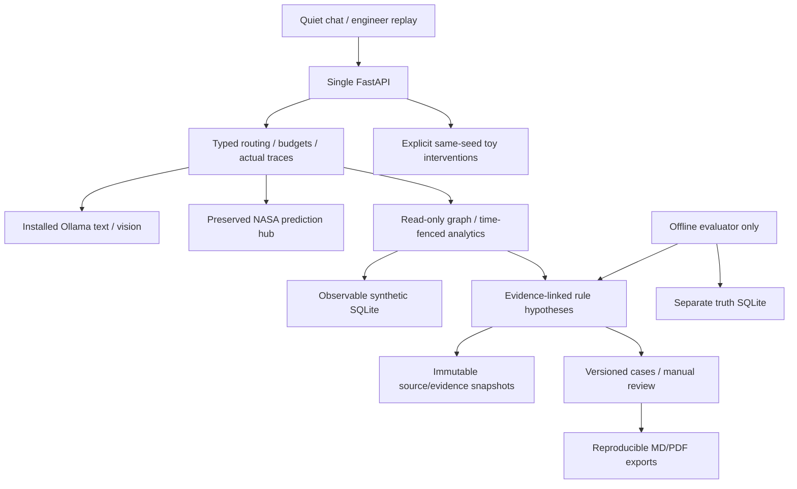
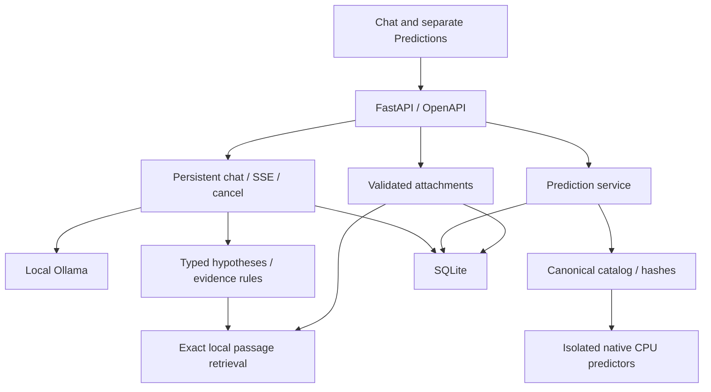

# V3.2 connected intelligence workspace

Current additions: app/orchestration/workspace.py and expanded tools.py dispatch actual scoped tools from main chat; web/features/workspace provides contextual engineering inspection. app/evidence/context.py uses bounded short model aliases with exact server-side source restoration. General hypothesis identity/merge/revision/budgets live in app/investigation; app/reports/evidence_case.py freezes uploaded cases separately from simulated facility reports. app/media and app/voice execute isolated, bounded optional local speech/video workers. Structured measurement profiles retain exact uploaded rows without NASA model transfer. Configuration and dependencies remain explicit and local-only. See V3_2_CAPABILITY_MATRIX.md and MEDIA_PROVENANCE.md for actual verification and limits.

Original V3 architecture below is preserved history; its voice/video outage and narrower routing descriptions predate V3.2.

---

# V3 additive control plane

V2 chat/prediction/storage contracts remain. Shared ledger/plan contracts feed independent simulation, temporal, graph, prediction, knowledge and report engines, then typed orchestration, additive API routes and the existing React presentation. No second app or destructive database rebuild.

The investigator only receives Observations, a read-only SQLite connection with table/ATTACH/write denial. It imports public settings, not generator truth assignments. Generator/what-if code computes toy observations; evaluator truth does not enter the tool context. No arbitrary file/SQL arguments, external providers or equipment commands are enabled. Generic uploaded documents are untrusted and retain separate provenance.

The current differential catalogue is nine canonical rules with explicit evidence expansion; unrestricted semantic hypothesis discovery and confirmed physical-case learning remain partial. Existing lexical document retrieval is used, not an uninstalled embedding model. Voice/video requests fail specifically; remaining modules continue. Current module/capability status is in V3_CAPABILITY_MATRIX.md.

---

# V2 architecture

One FastAPI process serves the SPA and `/api/v1`. Prediction and chat are independent domains; ordinary chat and image intake never select a hidden NASA unit.

Normal chat streams actual upstream content. Vision/hypothesis tools emit real progressive events. The provider has one local-model lock; native workers have a separate serial lock and 120-second timeout. Busy requests report 429. Native imports are isolated per process.

The hypothesis engine validates evidence IDs and separates measurements, user claims, guidance and model inference. It allows two proposal rounds and bounded passage searches under a wall-clock budget. Reliable direct boolean measurements of expected prerequisites can reject a mechanism; user confidence and generated visual observations cannot. Scores are heuristics, never probabilities. Unlinked NASA predictions are excluded from photographed-part scores; current image intake does not establish asset identity.

Knowledge ingestion validates/normalizes image bytes, extracts PDF pages and text line ranges, and previews CSV schema. Retrieval uses actual lexical matches. No embedding model or vector index is claimed. Uploaded content is untrusted evidence, never system permissions.

SQLite schema version 1 uses WAL, foreign keys and parameterized statements. `.runtime/v2` or `SIRE_STATE_DIR` stores chats, messages/status, attachments, chunks, cases and predictions. Attachment paths are local absolute paths; portable chat-state migration is not implemented. Confirmed chat deletion removes its attachments. This is single-user local software without remote authentication.

Layout adaptations: native `common/models/artifacts/data` stay together in `ml/artifacts/cmapss` for original relative loaders. Adapters live in `app/prediction`, avoiding duplicate runtime packages. Vision lives in intake/provider modules. Asset browsing shares Predictions. Blocked browser E2E is not represented by placeholder passing tests.
