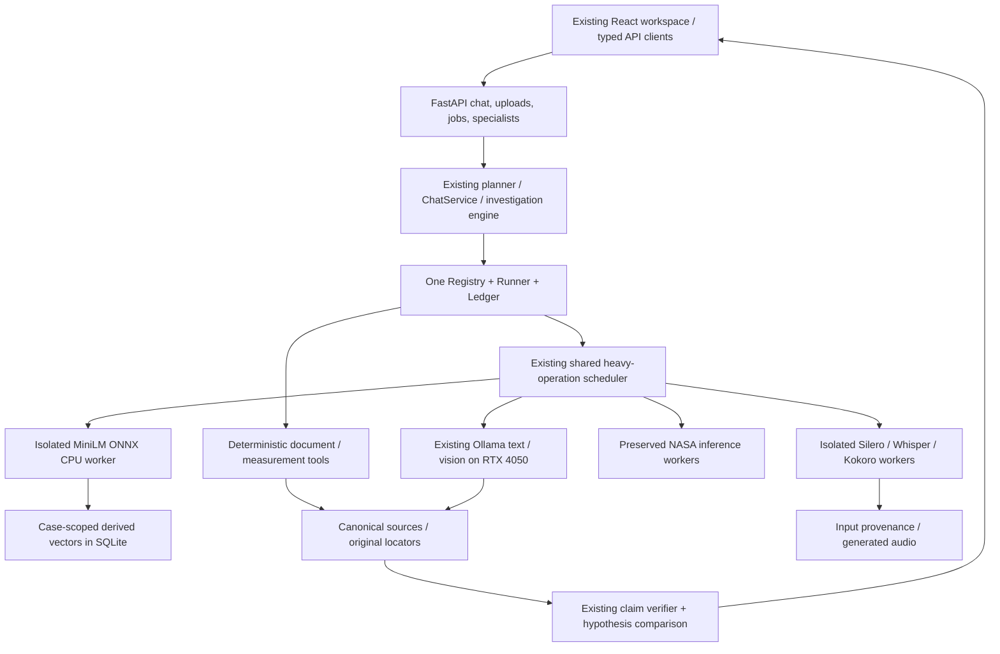

# Phase 2 architecture — 4.6.0

Checkpoint: 2026-11-18T12:23:47+05:30. Functional integration delivered; scientific/physical acceptance is limited as stated in [release readiness](PHASE2_RELEASE_READINESS.md). The application is local at http://127.0.0.1:8000. No frontend redesign, research retraining, destructive migration or public deployment.

`app/providers/contracts.py` supplies validated common outputs. `app/api/specialists.py` dispatches through the **existing** Runner, Registry and Ledger. `app/providers/specialists.py` adds real document, speech and sampled-video adapters; existing vision, ASR, measurements, retrieval and prediction registrations stay in `app/orchestration/tools.py`. There is no second GPU scheduler or specialist chatbot.

`app/knowledge/embeddings.py`, `embedding_worker.py` and `semantic.py` implement pinned lazy local embeddings and additive derived-vector storage. `search.py` retains exact lexical search and adds scoped semantic/hybrid selection. Derived index creation is lazy; production gained no table during read-only cutover. All 15 pre-existing tables compare exactly with the consistent pre-cutover snapshot.

`app/evidence/integrity.py` verifies owned attachment bytes and reproduces source chunks before reuse. `tabular.py` computes numeric CSV/XLSX summaries directly. Source identity and quoted/source agreement are separate from physical authenticity and causal correctness. Image/model descriptions remain unverified; speech transcripts are input provenance, and generated WAVs are outputs rather than evidence.

Long model work runs asynchronously or in bounded owned child workers. Existing background jobs remain durable. Model discovery/retrieval blocking work stays off the async loop. One shared OS lease coordinates cooperating SIRE processes; queue/accounting remains per worker. Launch policy allows one loaded Ollama family, one parallel generation, 4096 context and 120s bounded warm residency.

Root `.venv` and its external research-package link remain intact. Optional media dependencies stay in the existing isolated directory; only semantic inference packages were installed into `.runtime/semantic_deps`. No inference-time downloads. Windows x64 is the actually verified optional-wheel platform.

Rollback: consistent production snapshots and a 339-file source ZIP are private under `.runtime/phase2_20261118/`; SHA receipts in [validation summary](PHASE2_VALIDATION_SUMMARY.json). Stop only the verified local SIRE process before restoring application code. Keep original research, current user records, model folders and the GPU runtime intact; do not blindly replace a live database with an old snapshot.
