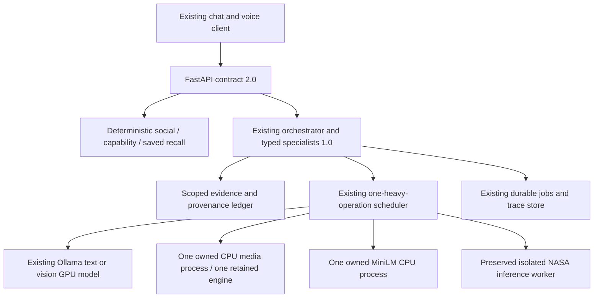

# Phase 3 architecture

SIRE 4.7.0 preserves the existing chat orchestrator, typed specialists, evidence ledger, durable jobs, local model catalog and frontend. Changes address measured repeated CPU initialization and routing/lifecycle defects. This is a local engineering release with acceptance limits in [release readiness](PHASE3_RELEASE_READINESS.md).

`app/core/worker_pool.py` provides bounded JSON-file IPC, owned process handles, deadlines, cancellation, source-generation binding, parent-EOF exit, and idle eviction. It does not add a second scheduler. Each request executes actual inference; process/model reuse is distinct from an exact-output cache hit. The media process retains one heavy engine/profile, dropping the prior one when switching ASR/TTS. The embedding process retains one tokenizer/session. Each idles out after 90 seconds.

Native libraries load before the stdin watcher; the reverse order reproducibly stalled Windows initialization. The observed stack established import-order sensitivity, not the exact underlying DLL-lock mechanism. Protocol/process failures can explicitly fall back to original one-shot execution of the same model. Integrity errors, cancellation and deadlines do not silently substitute a result. Controlled fallback produced an actual WAV; lifecycle controls use actual child handles.

The original scheduler still governs GPU/CPU-heavy calls. Ollama holds one loaded model, one parallel request and 120-second keepalive. Fast deterministic conversation/status/recall bypass inference and stayed responsive during a real investigation. Media locks and the OS heavy-operation lease remain. See [scheduling](PHASE3_MODEL_SCHEDULING.md).

No database schema migration, frontend redesign, model download, retraining, research cleanup, paid service or public listener was added. Canonical native paths and the external virtualenv dependencies stay in place. Production was read-only during QA; live user additions were preserved and the immediate cutover backup matches all 15 tables. [Preservation evidence](PHASE3_ARTIFACT_AUDIT.md).

Stable API contracts and streaming limits are in [Phase 4 handoff](PHASE4_BACKEND_HANDOFF.md). Machine-readable timings, conditions and receipt hashes are in [results](PHASE3_RESULTS.json).
