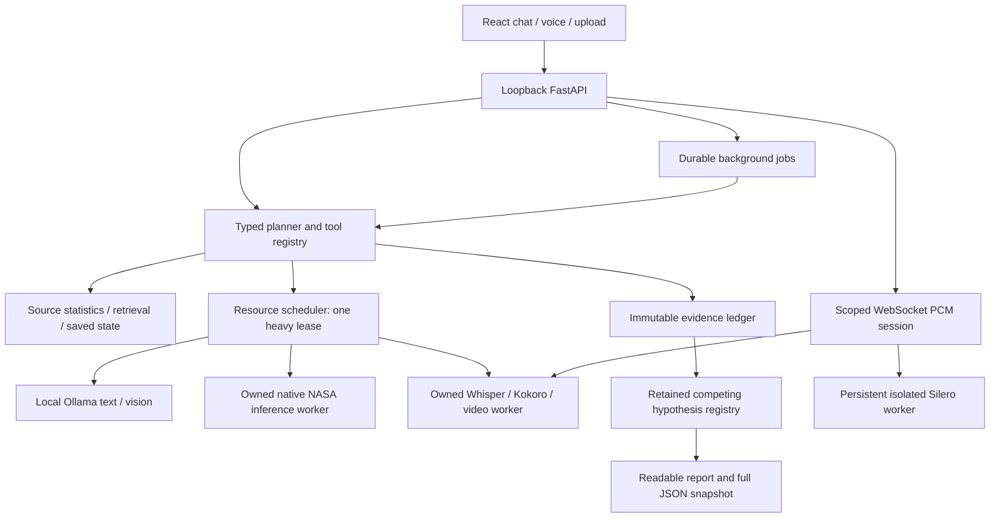

# SIRE V4.5 actual architecture

This is a local engineering preview, not a fully accepted real-time voice release. See [release readiness](V45_RELEASE_READINESS.md) for measured gates and gaps. V4 source/database checkpoints remain under `.runtime/v45/backups/`; the existing V2 database and trained artifacts are preserved.

## Shared intelligence, two execution paths

React sends ordinary requests to `POST /api/v1/chat/message`. FastAPI builds a bounded typed orchestration plan, executes registered local tools, persists actual trace events, and returns SSE. Exact source excerpts/statistics and saved-case/status questions use deterministic paths. Other conversation uses the configured local Qwen text model.

Explicit Investigate or an opted-in deep request creates a durable `v45_jobs` record and returns202. A separate ChatService task uses the same evidence, retrieval, vision and hypothesis tools. Chat remains usable in the same conversation. Foreground model work can queue behind an already executing heavy operation; priority does not preempt inference. Deterministic status/recall does not need that slot.

## Boundaries and persistence

- `app/orchestration/`: actual plans, typed adapters, bounded execution, cancellation and saved state. This is conservative routing with explicit tools, not an unconstrained autonomous planner.
- `app/evidence/`: immutable source identities, original/stored hashes, source inventory, numerical verification and historical availability clocks. Source agreement does not authenticate physical measurements.
- `app/investigation/`: dynamic proposals, lexical identity/deduplication, scoped registry, evidence heuristics, bounded local follow-up and explicit partial/error states.
- `app/providers/resources.py`: actual OS file lock across cooperating SIRE processes; bounded per-worker queue and measured wait/work history. It cannot enforce GPU allocation by unrelated programs or old workers.
- `app/voice/`: PCM session/VAD plus final-only Whisper. No fake partial words, word alignment or neural audio streaming.
- `app/prediction/`: original dataset-specific preprocessing/model worker; immutable168-route catalog. Three selected roles are annotations, not model deletion or retraining.
- SQLite receives additive `v45_jobs` and `v45_voice_sessions` tables. Interrupted jobs are marked interrupted on restart; automatic resumption is not claimed. Recent job events are bounded; actual run traces and saved results remain separate.

The SPA and API share one loopback origin. External AI is disabled. Markdown remote images no longer fetch automatically. Start controls request microphone access; private browser permission remains under the operator's control.

## Important implementation limits

One local worker and one active background job are the supported execution shape. Optional provider descriptors are discovery metadata, not implemented adapters. Model proposals and visual interpretations remain unverified; semantic entailment and physical root cause are not universally decided by this verifier. See the capability matrix for exact acceptance scope.
